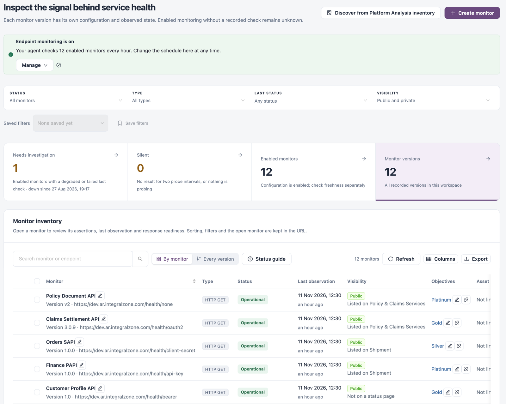
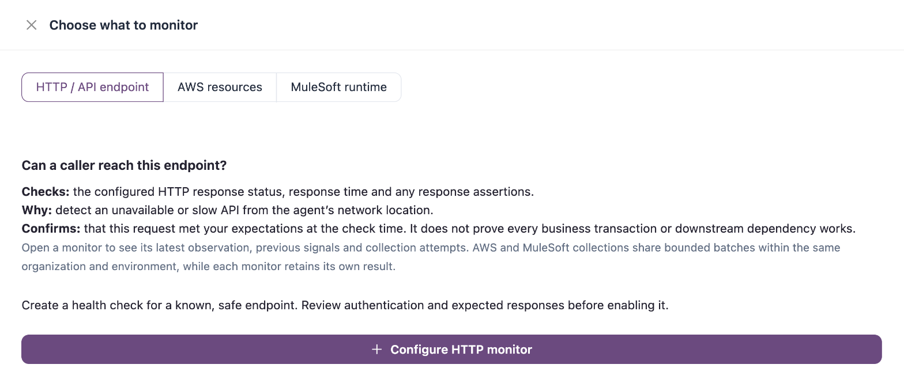
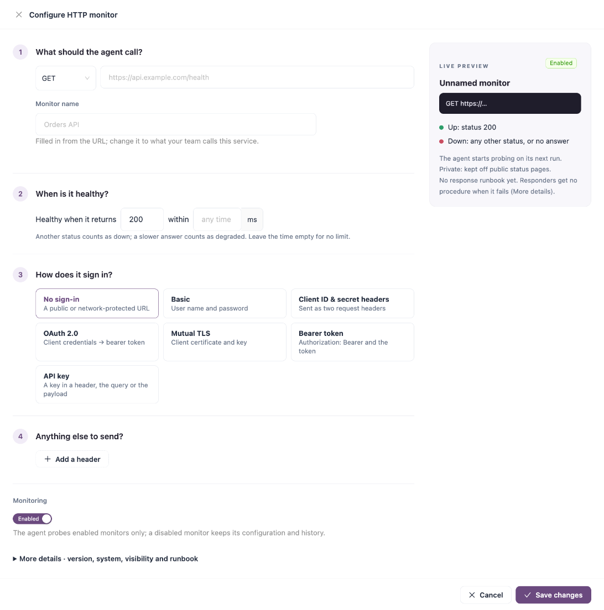
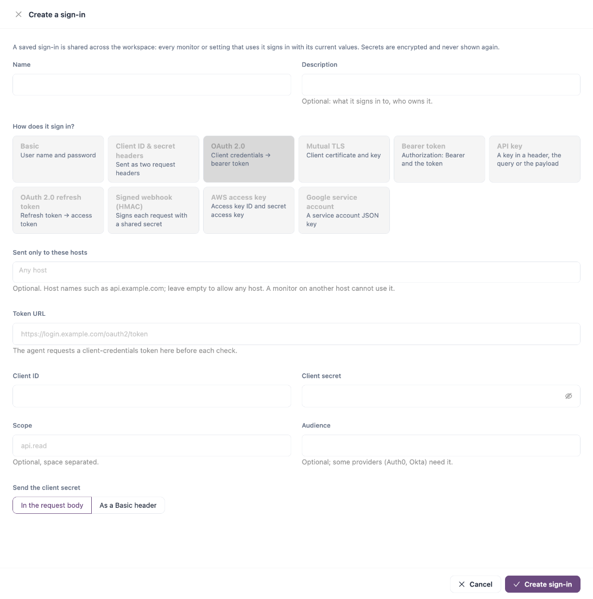

# Monitors

A monitor checks one service and records what it observed. An HTTP monitor calls an endpoint from your agent and compares the answer with what you expect. A resource monitor collects the state that AWS, MuleSoft or Azure reports for an asset. Each monitor can have several versions, each with its own URL, sign-in and results.

Open it from **Workspaces** → **Service Health** → **Monitors** in the sidebar.


Requires the **Service Health** licence. Health checks run on your agent, from its network.


<figure><figcaption>
Monitors
</figcaption></figure>

**Discover from Platform Analysis inventory** opens [Monitoring Coverage](monitoring-coverage.md), which suggests monitors for the applications Platform Analysis has found. **Create monitor** adds one yourself; see [Create a monitor](monitors.md#create-a-monitor).

## Setup Notice

A notice at the top of the page shows the next step to get monitoring running, with a button for it:

| Notice                                 | What to do                                                                                                                   |
| -------------------------------------- | ---------------------------------------------------------------------------------------------------------------------------- |
| **Service health isn't turned on yet** | Click **Turn on Service health**.                                                                                            |
| **Connect an agent**                   | Click **Set up the agent**: health checks run on your agent, from its network.                                               |
| **Create your first monitor**          | Click **Create monitor**.                                                                                                    |
| **Enable a monitor**                   | Monitors are saved but none is enabled. Enable one from its row actions or the monitor form.                                 |
| **Turn on health checks**              | Click **Schedule health checks** and choose how often the agent checks.                                                      |
| **Waiting for the first check**        | Results appear after your agent's next run.                                                                                  |
| **Endpoint monitoring is on**          | Shows how many enabled monitors the agent checks and how often. **Manage** → **Health check schedule** changes the schedule. |

These buttons open the same steps as [Setup](../../administration/setup.md).

## Filters and Tiles

| Filter          | Options                                                                                                                   |
| --------------- | ------------------------------------------------------------------------------------------------------------------------- |
| **Status**      | **All monitors**, **No observations**, **Silent**, **Disabled**.                                                          |
| **Type**        | **HTTP endpoints**, **AWS resources**, **MuleSoft runtimes**, **Azure resources**.                                        |
| **Last status** | One or more of **Operational**, **Degraded performance**, **Partial disruption**, **Down**, **Maintenance**, **Unknown**. |
| **Visibility**  | **Public** or **Private**.                                                                                                |

Use **Save filters** to keep a combination and pick it again from **Saved filters**.

| Tile                    | Description                                                                                           |
| ----------------------- | ----------------------------------------------------------------------------------------------------- |
| **Needs investigation** | Enabled monitors whose last check was degraded or failed, and how long the longest one has been down. |
| **Silent**              | Monitors with no result for two probe intervals, or nothing probing at all.                           |
| **Enabled monitors**    | Monitors whose configuration is enabled. Check freshness separately.                                  |
| **Monitor versions**    | All recorded versions in the workspace.                                                               |

Click a tile to filter the list.

## Monitor Inventory

The toolbar has a search box (monitor or endpoint), **Refresh**, **Columns** and **Export this page**, plus:

* **By monitor** shows one row per monitor; a monitor with several versions expands into them. **Every version** lists each version as its own row.
* **Status guide** explains each status.

| Column               | Description                                                                                                                                                                                                            |
| -------------------- | ---------------------------------------------------------------------------------------------------------------------------------------------------------------------------------------------------------------------- |
| **Monitor**          | Monitor name, version and URL or resource identifier. Click it to open the monitor. The pencil next to the name (**Edit display name**) renames the monitor for all its versions; leave the name blank to use the URL. |
| **Type**             | For example **HTTP GET**, **AWS LAMBDA** or **MuleSoft CloudHub 2.0**.                                                                                                                                                 |
| **Status**           | The last observed status, **Silent**, **No observations** or **Disabled**.                                                                                                                                             |
| **Last observation** | When the monitor last recorded a result.                                                                                                                                                                               |
| **Visibility**       | **Public** or **Private**, and the status pages it is listed on or hidden from.                                                                                                                                        |
| **Objectives**       | The service objectives that cover the monitor, each with **Change objective** and **Remove from objective**, or **Set objective**. Resource monitors show **Not measured for resource monitors**.                      |
| **Asset**            | **Open asset** opens the linked application in Platform Analysis; otherwise **Linked** or **Not linked**.                                                                                                              |
| **Actions**          | **Inspect monitor** and **Edit monitor**; **More actions** holds **Disable monitor** or **Enable monitor**, and delete. Edit, enable and disable are for HTTP monitors only.                                           |

| Status                   | Meaning                                                                                     |
| ------------------------ | ------------------------------------------------------------------------------------------- |
| **Operational**          | The last check got the expected status code within the time limit.                          |
| **Degraded performance** | The expected status code, but slower than the time limit.                                   |
| **Down**                 | Another status code, or no answer at all.                                                   |
| **Maintenance mode**     | Inside a maintenance window: checks run but do not count as down.                           |
| **Silent**               | Enabled, but no new result for two check intervals, or no health check schedule is running. |
| **No observations**      | Enabled, but never checked yet.                                                             |
| **Disabled**             | Not checked: the agent skips disabled monitors.                                             |

### Bulk Actions

Tick monitors to show the bulk bar: **Enable**, **Disable**, **Make public**, **Make private** and **Clear selection**. One change covers at most 100 monitors.

## Inspect a Monitor

Click a monitor name or **Inspect monitor** to open **Monitor evidence & configuration**:

* **Linked application**, with **Link an application** to link the monitor to an application.
* **History**: the last 90 UTC days as a status page would show them, uptime, and recent incidents.
* **Last check**: the request the agent sent and what came back. Every run's log is in [Execution History](../../operations/schedules/execution-history.md).
* The configuration: endpoint, HTTP method, version, monitoring state, last observation, expected response and response threshold.
* **Add another version** (HTTP monitors) and **Versions**, which lists each version with its URL and status.
* **Response readiness**: the linked runbook, links to runbooks and maintenance windows, and the service objectives that cover the monitor.

## Create a Monitor

The button to the left of **Create monitor** opens [Monitoring Coverage](monitoring-coverage.md), where you start from discovered applications instead.

1. Click **Create monitor**.
2. In **Choose what to monitor**, pick one:
   * **HTTP / API endpoint**: checks the response status, response time and any response assertions. Click **Configure HTTP monitor** and continue with [Create an HTTP monitor](monitors.md#create-an-http-monitor).
   * **AWS resources**: uses the AWS integration already configured for your organization. Choose assets from the suggestions, or enable a monitoring policy.
   * **MuleSoft runtime**: uses the Anypoint Sync connected app already configured. Monitors Runtime Manager applications (CloudHub 2.0, Runtime Fabric, CloudHub 1.0, hybrid) and API Manager instances.

<figure><figcaption>
Choose what to monitor
</figcaption></figure>

The AWS and MuleSoft choices show the same suggestions as [Monitoring Coverage](monitoring-coverage.md).

## Create an HTTP Monitor

The form has four numbered steps and a **Live preview** on the right that shows the request the agent will send and how its answer is judged. Secrets are masked in the preview.

<figure><figcaption>
Configure HTTP monitor
</figcaption></figure>

| Field                                             | Description                                                                                                                                                                                         |
| ------------------------------------------------- | --------------------------------------------------------------------------------------------------------------------------------------------------------------------------------------------------- |
| Method                                            | **Required.** **GET**, **POST** or **PUT**.                                                                                                                                                         |
| URL                                               | **Required.** The full URL to call, starting with `https://` (for example `https://api.example.com/health`).                                                                                        |
| **Monitor name**                                  | **Required.** Filled in from the URL; change it to what your team calls the service. Up to 100 characters. Every version of a monitor shares its name.                                              |
| **Healthy when it returns** … **within** … **ms** | The expected status code (default `200`) and an optional response time limit in milliseconds. Another status counts as down; a slower answer counts as degraded. Leave the time empty for no limit. |
| **How does it sign in?**                          | **Required.** **No sign-in** or one of the sign-in types below.                                                                                                                                     |
| **Add a header**                                  | Optional headers sent with every check: a header name and a value.                                                                                                                                  |
| **Monitoring**                                    | **Enabled** or **Disabled**. The agent probes enabled monitors only; a disabled monitor keeps its configuration and history.                                                                        |

Expand **More details · version, system, visibility and runbook** for:

| Field                | Description                                                                            |
| -------------------- | -------------------------------------------------------------------------------------- |
| **Version**          | **Required.** For example `1.0`. Each version keeps its own configuration and results. |
| **System**           | Optional. When set, only agents associated with this system run the check.             |
| **Visibility**       | **Public** or **Private**. Only a public monitor can appear on public status pages.    |
| **Response runbook** | The runbook the responding team follows when this monitor fails. Search by name.       |

Click **Save changes**. The next check runs on the agent's schedule once the monitor is enabled.

### Sign-in Types

When a monitor needs to sign in, choose a type and then a **Saved sign-in** of that type. A saved sign-in is shared across the workspace: every monitor that uses it signs in with its current values, and its secrets are encrypted and never shown again.

* Pick an existing one from **Saved sign-in**, or click **New sign-in…** to create one without leaving the form.
* After you pick one, the edit button next to it changes that saved sign-in for everything that uses it.

<figure><figcaption>
Create a sign-in from the monitor form
</figcaption></figure>

Every new sign-in has a **Name** (**Required**), an optional **Description**, and **Sent only to these hosts**: optional host names such as `api.example.com`. When you list hosts, a monitor on another host cannot use the sign-in. The type is fixed to the one you chose in the monitor form. The other fields depend on the type:



For a public or network-protected URL. Nothing is added to the request.



| Field         | Description                                   |
| ------------- | --------------------------------------------- |
| **User name** | **Required.**                                 |
| **Password**  | **Required.** Sent as `Authorization: Basic`. |



Sent as two request headers.

| Field                    | Description                                                            |
| ------------------------ | ---------------------------------------------------------------------- |
| **Client ID header**     | **Required.** Header name for the client ID, for example `client_id`.  |
| **Client ID**            | **Required.**                                                          |
| **Client secret header** | **Required.** Header name for the secret, for example `client_secret`. |
| **Client secret**        | **Required.**                                                          |



The agent requests a client-credentials token before each check and sends it as `Authorization: Bearer`.

| Field                      | Description                                                                                         |
| -------------------------- | --------------------------------------------------------------------------------------------------- |
| **Token URL**              | **Required.** Full URL of the token endpoint, for example `https://login.example.com/oauth2/token`. |
| **Client ID**              | **Required.**                                                                                       |
| **Client secret**          | **Required.**                                                                                       |
| **Scope**                  | Optional, space separated.                                                                          |
| **Audience**               | Optional; some providers need it.                                                                   |
| **Send the client secret** | **In the request body** or **As a Basic header**.                                                   |



The agent presents a client certificate.

| Field                  | Description                                                                                        |
| ---------------------- | -------------------------------------------------------------------------------------------------- |
| **Client certificate** | **Required.** The certificate and any intermediates, in PEM. Paste it or use **Load from a file**. |
| **Private key**        | **Required.** In PEM. Written to a private temporary file for each check, then deleted.            |
| **Key passphrase**     | Only if the private key is encrypted.                                                              |
| **Server CA bundle**   | Optional. With a CA bundle the agent verifies the server certificate; without one it does not.     |



| Field     | Description                                                  |
| --------- | ------------------------------------------------------------ |
| **Token** | **Required.** Sent as `Authorization: Bearer` and the token. |



| Field               | Description                                                                              |
| ------------------- | ---------------------------------------------------------------------------------------- |
| **Send the key in** | **A header** or **The query string**.                                                    |
| **Name**            | **Required.** The header or query parameter that holds the key, for example `X-Api-Key`. |
| **Prefix**          | Optional. One word written before the key.                                               |
| **Key**             | **Required.**                                                                            |




Saved sign-in secrets cannot be read back. When you edit a saved sign-in, leave a secret blank to keep the stored value.


A monitor created before saved sign-ins keeps its own credentials, or reads them from a global setting, until you switch it. Editing such a monitor shows **Sign in with**: **Use a saved sign-in**, or **Keep its current sign-in** / **Keep the global setting**.

## Add a Version

1. Inspect the monitor and click **Add another version**.
2. Change the URL, sign-in or expectations for the new version and give it a **Version** label.
3. Click **Save changes**.


You need a role that can create monitors to create monitors and versions, a role that can edit monitors to edit, enable, disable or change visibility, and a role that can delete monitors to delete a version.



A monitor that a current service objective covers cannot be deleted. Remove it from the objective first.


## Next Steps

* [Monitoring Coverage](monitoring-coverage.md): find applications that still need a monitor.
* [Runbooks](runbooks.md): write the procedure linked from a monitor.
* [Service Objectives](service-objectives.md): measure monitors against a target.
* [Saved Sign-ins](../../administration/global-settings/saved-sign-ins.md): manage the sign-ins monitors use.
