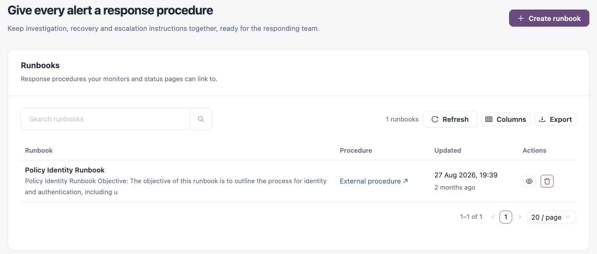
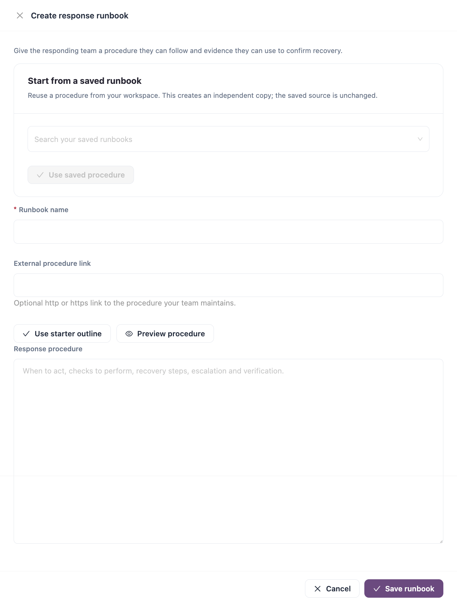

# Runbooks

A runbook is the response procedure for a failing service: when to act, what to check, how to recover, whom to escalate to and how to confirm recovery. You link a runbook to a monitor so responders find it from the monitor and its status page.

Open it from **Workspaces** → **Service Health** → **Runbooks** in the sidebar.


Requires the **Service Health** licence.


<figure><figcaption>
Runbooks
</figcaption></figure>

## Runbooks List

The list has a search box, **Refresh**, **Columns** and **Export**.

| Column        | Description                                                                                                           |
| ------------- | --------------------------------------------------------------------------------------------------------------------- |
| **Runbook**   | Runbook name and the start of its procedure. Click the name to read it.                                               |
| **Procedure** | **Written in IZ Suite**, or **External procedure ↗** when the runbook links to a procedure your team keeps elsewhere. |
| **Updated**   | When the runbook last changed.                                                                                        |
| **Actions**   | **Read runbook** and delete.                                                                                          |


A monitoring policy creates starter runbooks for the resource types it monitors. Edit them freely: the policy never overwrites or re-creates them.


## Create a Runbook

<figure><figcaption>
Create response runbook
</figcaption></figure>

1. Click **Create runbook**.
2. To reuse an existing procedure, search under **Start from a saved runbook** and click **Use saved procedure**. This creates an independent copy; the saved runbook is unchanged.
3. Fill in the fields below. Click **Use starter outline** to start from sections for when to use the procedure, the evidence to check, the response and how to verify recovery.
4. Click **Preview procedure** to see the formatted text, and **Edit procedure** to go back.
5. Click **Save runbook**.

| Field                       | Description                                                                                             |
| --------------------------- | ------------------------------------------------------------------------------------------------------- |
| **Runbook name**            | **Required.** Up to 100 characters.                                                                     |
| **External procedure link** | Optional `http` or `https` link to the procedure your team maintains.                                   |
| **Response procedure**      | The procedure in Markdown: when to act, checks to perform, recovery steps, escalation and verification. |

## Read a Runbook

Click **Read runbook** on a row. The drawer shows:

* **Edit runbook**, **Open external procedure** (when a link is set) and **Download procedure** (a Markdown file).
* **Response procedure**: the formatted procedure.
* **Monitors using this procedure**: each linked monitor version and whether it is enabled. Click one to open it in [Monitors](monitors.md).

## Link a Runbook to a Monitor

Edit the monitor, expand **More details · version, system, visibility and runbook**, and choose the runbook in **Response runbook**. See [Monitors](monitors.md#create-an-http-monitor).


A runbook that is still linked to monitors cannot be deleted, unless a monitoring policy created it. You need a role that can create monitors to create runbooks, a role that can edit monitors to edit them, and a role that can delete monitors to delete them.


## Next Steps

* [Monitors](monitors.md): link the runbook to the monitors it covers.
* [Maintenance Windows](maintenance-windows.md): plan the work a runbook describes.
* [Service Readiness](service-readiness.md): track how many services have a response procedure.
