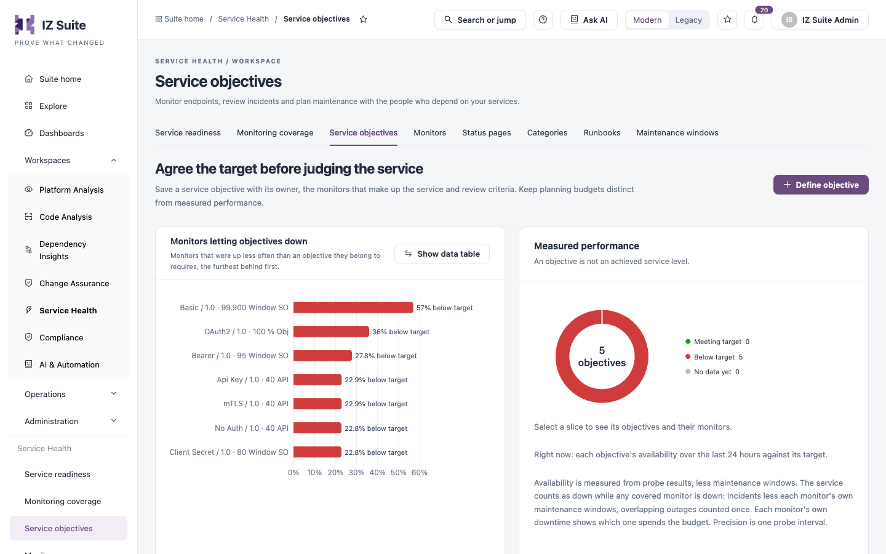
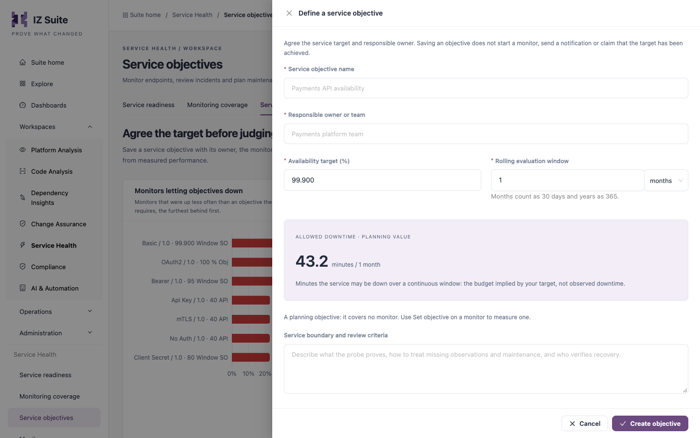

# Service Objectives

A service objective is an availability target, such as 99.9% over one month, agreed with the owner of a service. It covers one or more HTTP monitors and is measured from their probe results. Use this screen to define objectives and to see how each one is doing.

Open it from **Workspaces** → **Service Health** → **Service objectives** in the sidebar.


Requires the **Service Health** licence. Objectives measure HTTP monitors only; AWS, MuleSoft and Azure resource monitors are not measured against an objective.


<figure><figcaption>
Service objectives and their charts
</figcaption></figure>

## Charts

| Chart                                           | What it shows                                                                                                                                                                                                     |
| ----------------------------------------------- | ----------------------------------------------------------------------------------------------------------------------------------------------------------------------------------------------------------------- |
| **Monitors letting objectives down**            | Each monitor that was up less often than an objective it belongs to requires, furthest behind first, with how far below target it is.                                                                             |
| **Measured performance**                        | A donut of all current objectives: **Meeting target**, **Below target** and **No data yet**, using each objective's availability over the last 24 hours. Click a slice to list its objectives and their monitors. |
| **Objectives meeting their target, day by day** | For each of the last 30 days, how many objectives kept their target (**Met target**) and how many did not (**Below target**). Empty days had nothing measured.                                                    |

Click **Show data table** on a chart to see its values as a table.


Availability is measured from probe results, less maintenance windows. The service counts as down while any covered monitor is down; overlapping outages are counted once. Precision is one probe interval.


## Service objectives list

Use the **Status** filter to show **Current** or **Archived** objectives. The list has a search box (objectives or owners), **Refresh**, **Columns** and **Export**. Expand a row to see its measurements and monitors.

| Column        | Description                                                                                           |
| ------------- | ----------------------------------------------------------------------------------------------------- |
| **Objective** | Objective name and owner.                                                                             |
| **Target**    | The availability target and window, and the allowed downtime it implies (a planning value).           |
| **Status**    | **Met**, **At risk**, **Missed** or **Not measured yet**, and **Archived** for an archived objective. |
| **Monitors**  | Number of covered monitors (click to list them), or **Planning objective** when it covers none.       |
| **Actions**   | **Edit objective**, **Export objective**, and **Archive objective** or **Restore objective**.         |

An expanded row shows **Availability**, **Downtime** against the allowed downtime, **Error budget left** and **Average burn**, followed by the covered monitors with the most downtime first.


You cannot archive an objective while it covers enabled monitors. Remove them from the objective first. Archiving does not change any monitor or schedule.


## Define a service objective

<figure><figcaption>
Define a service objective
</figcaption></figure>

1. Click **Define objective**.
2. Fill in the fields below. The **Allowed downtime · planning value** box shows the minutes of downtime your target allows over the window.
3. Click **Create objective**.

| Field                                    | Description                                                                                                       |
| ---------------------------------------- | ----------------------------------------------------------------------------------------------------------------- |
| **Service objective name**               | **Required.** Up to 160 characters.                                                                               |
| **Responsible owner or team**            | **Required.** Who reviews the objective. Up to 160 characters.                                                    |
| **Availability target (%)**              | **Required.** Between 90 and 100.                                                                                 |
| **Rolling evaluation window**            | **Required.** A number of days, months or years, from 1 day to 3 years. Months count as 30 days and years as 365. |
| **Service boundary and review criteria** | What the probe proves, how to treat missing observations and maintenance, and who verifies recovery.              |

An objective created here covers no monitor yet. Saving it does not start a monitor or send a notification.

## Add monitors to an objective

You add monitors from the monitor side:

1. Open [Monitors](monitors.md).
2. In the **Objectives** column of an HTTP monitor, click **Set objective**, or open the monitor and click **Define a service objective for this monitor** or **Add another service objective**.
3. Choose a **Service objective**, or click **Define objective** to create one for this monitor.

To move a monitor to another objective, click the covered-monitors count on the objective, then **Change objective** on the monitor. An objective covers up to 50 monitors.


You need a role that can create or edit monitors to define, edit, archive objectives and add monitors to them.


## Next steps

* [Monitors](monitors.md): add monitors to an objective.
* [Maintenance Windows](maintenance-windows.md): keep planned work out of the measurement.
* [Service Health](./): see how the screens fit together.
