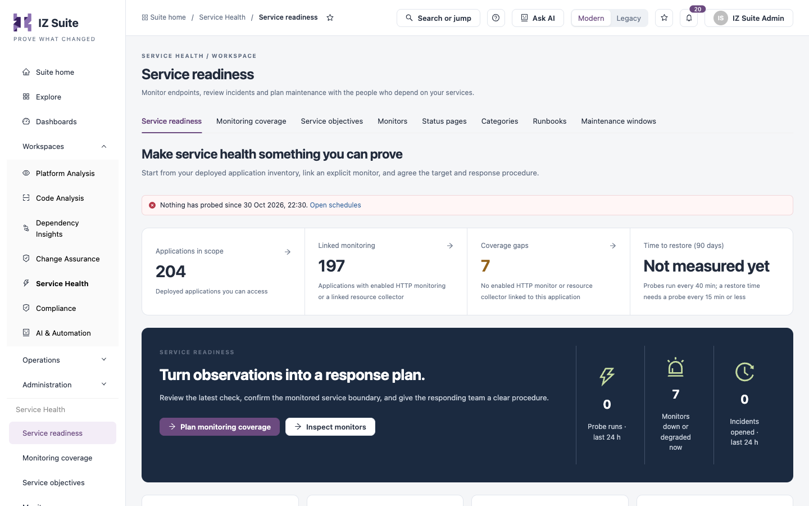

# Service Readiness

Service readiness is the start page of Service Health. It shows whether checks are running, how many monitors need attention, and which deployed applications still have no monitor.

Open it from **Workspaces** → **Service Health** → **Service readiness** in the sidebar.


Requires the **Service Health** licence.


<figure><figcaption>
Service readiness
</figcaption></figure>

## Probe notice

A red notice appears at the top when checks have stopped:

| Notice                                                              | What it means                                                                         |
| ------------------------------------------------------------------- | ------------------------------------------------------------------------------------- |
| **Nothing has probed since** a date, or **Nothing has probed yet.** | The health check schedule has not run recently. Click **Open schedules** to check it. |
| **No API Health Check schedule is active.**                         | No schedule runs your monitors. Click **Open schedules** to create or enable one.     |
| **Probe results are refused**                                       | The checks allowance of your licence is used up. Click **Review licence details**.    |

## Tiles

| Tile                          | Description                                                                                                                                                       |
| ----------------------------- | ----------------------------------------------------------------------------------------------------------------------------------------------------------------- |
| **Applications in scope**     | Deployed applications you can access. Click it to open [Monitoring Coverage](monitoring-coverage.md).                                                             |
| **Linked monitoring**         | Applications with an enabled HTTP monitor or a linked resource collector. Click it to see them in Monitoring Coverage.                                            |
| **Coverage gaps**             | Applications with no enabled HTTP monitor or resource collector. Click it to see them in Monitoring Coverage.                                                     |
| **Time to restore (90 days)** | Mean and 90th percentile time to recover from resolved outages, less maintenance. It shows **Not measured yet** when probes run less often than every 15 minutes. |

## Service readiness panel

The panel shows three live signals: **Probe runs · last 24 h**, **Monitors down or degraded now** and **Incidents opened · last 24 h**.

* **Plan monitoring coverage** opens [Monitoring Coverage](monitoring-coverage.md).
* **Inspect monitors** opens [Monitors](monitors.md).

Below it, four numbered steps count what is in place across the whole workspace:

| Step                     | Counts                               |
| ------------------------ | ------------------------------------ |
| **Know the service**     | Applications you are allowed to see. |
| **Connect a monitor**    | Enabled HTTP monitor versions.       |
| **Collect observations** | Probe runs in the last 24 hours.     |
| **Prepare a response**   | Response runbooks.                   |

## Start with an actual application

This list shows a few applications that have no linked monitor yet, with their type, organization and environment. Click **View all applications →** to see the full list in Monitoring Coverage.

| Button                | What it does                                                                                                         |
| --------------------- | -------------------------------------------------------------------------------------------------------------------- |
| **Configure monitor** | Opens the HTTP monitor form, already linked to this application. See [Monitors](monitors.md#create-an-http-monitor). |
| **Open monitor**      | Shown when the application already has a monitor. Opens the **Monitor evidence & configuration** drawer.             |


You need a role that can view monitors to see the tiles and lists. Without it, the page offers only links to status pages, runbooks and maintenance windows. To configure a monitor you need a role that can create monitors.


## Next steps

* [Monitoring Coverage](monitoring-coverage.md): close the coverage gaps.
* [Monitors](monitors.md): inspect what each monitor last observed.
* [Runbooks](runbooks.md): give responders a procedure.
* Schedules: check the schedule that runs health checks.
