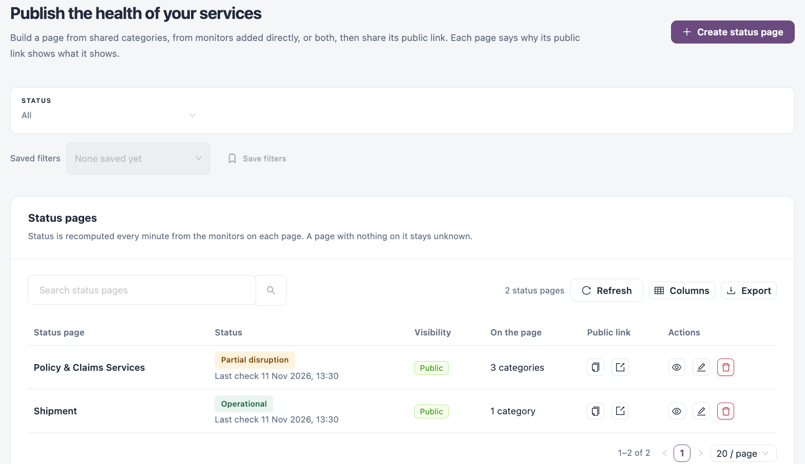
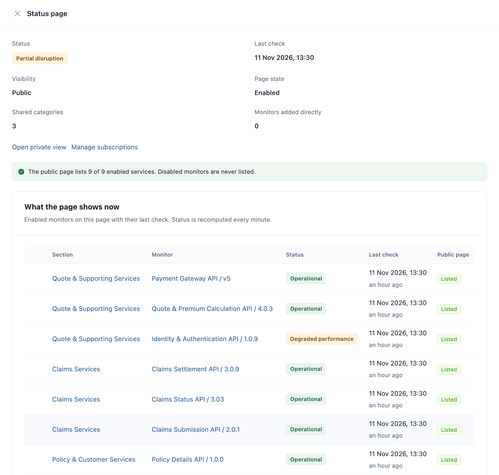

# Status Pages

A status page shows the current health of a set of services to the people who depend on them. You build it from shared categories, from monitors added directly, or both, and share its public link. The status of a page is computed every minute from its monitors; it is never set by hand.

Open it from **Workspaces** → **Service Health** → **Status pages** in the sidebar.


Requires the **Service Health** licence.


<figure><figcaption>
Status pages
</figcaption></figure>

## Status Pages List

Use the **Status** filter to show **All**, **Needs attention**, **Private** or **Disabled** pages; **Save filters** keeps a combination to pick again from **Saved filters**. The list has a search box, **Refresh**, **Columns** and **Export**.

| Column          | Description                                                                                                                                                                     |
| --------------- | ------------------------------------------------------------------------------------------------------------------------------------------------------------------------------- |
| **Status page** | Page name. Click it to open the owner view (**Owner View** below).                                                                                                              |
| **Status**      | The page status and its last check. A page with nothing on it stays **Unknown**.                                                                                                |
| **Visibility**  | **Public** or **Private**, **Disabled** when the page is turned off, and a **Managed by** tag when a monitoring policy maintains the page.                                      |
| **On the page** | How many categories and directly added monitors the page shows, or **Nothing added yet**.                                                                                       |
| **Public link** | **Copy public link** and **Open public page** for an enabled public page. A private page shows **Private · no public link**; a disabled page shows that its link shows nothing. |
| **Actions**     | **Review page**, **Edit settings** and delete.                                                                                                                                  |

## Owner View

Click a page name to open its owner view. It shows the page as its audience sees it, plus private monitors that the public link never shows. Only signed-in users with status page access see it. From there you can **Copy public link**, **Open public page**, **Configure page**, open **Maintenance windows** and **Subscribe to updates**. The **Current status**, **Uptime** and **Incident history** tabs show the live state, past availability and incidents.

## Create a Status Page

1. Click **Create status page**.
2. Fill in the fields below.
3. Click **Create status page**. The new page opens in the review drawer, where you can keep adding content.

| Field                       | Description                                                                                                                         |
| --------------------------- | ----------------------------------------------------------------------------------------------------------------------------------- |
| **Status page name**        | **Required.** Up to 100 characters.                                                                                                 |
| **Visibility**              | **Public**: the page has a link anyone can open. **Private**: no public link; signed-in users open its private view from this list. |
| **Page state**              | **Enabled** or **Disabled**. A disabled page shows nothing on its public link.                                                      |
| **Shared categories**       | Optional. Each category shows its monitors under its own heading.                                                                   |
| **Monitors added directly** | Optional. Listed in the page's own **Services** section, first on the public page.                                                  |

**Edit settings** on a row changes the name, visibility and page state.

## Review a Page

Click **Review page** on a row.

<figure><figcaption>
Review a status page
</figcaption></figure>

The drawer shows:

* The status, last check, visibility, page state and the number of shared categories and directly added monitors.
* **Open private view** and **Manage subscriptions**, where people subscribe to updates about the page.
* A notice that says how many enabled services the public page lists, and why.
* **What the page shows now**: each enabled monitor with its section, status, last check and **Public page** state: **Listed**, **Private view only** (the monitor is private), **Category hidden** or **Not published** (the page is private or disabled).
* **Monitors added directly**: search and click **Add monitor to page**, or **Remove monitor**.
* **Shared categories**: search and click **Add category to page**, or **Remove category**. **Manage categories →** opens [Categories](categories.md).


Only public, enabled monitors appear on a public page. Disabled monitors are never listed.


### Pages Maintained by a Monitoring Policy

A page created by a monitoring policy shows **Maintained by** in its drawer. The policy adds a section per asset type as it creates monitors. Click **Take over** to stop the policy maintaining the page; everything on it stays as it is, and from then on you change it yourself.


You need a role that can create status pages to create one, a role that can edit status pages to change settings or content, and a role that can delete status pages to delete one or remove a category from it. Adding monitors also needs a role that can view monitors.


## Next Steps

* [Categories](categories.md): group monitors once and reuse them on several pages.
* [Monitors](monitors.md): make monitors public so they can appear on public pages.
* [Maintenance Windows](maintenance-windows.md): announce planned work on a page.
